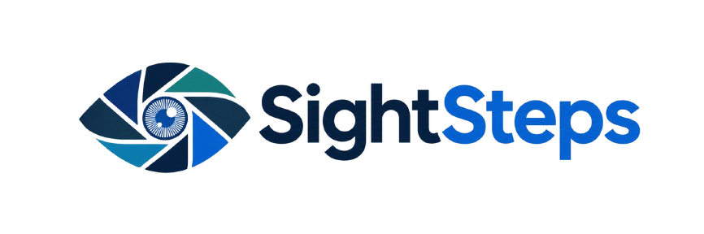

# SightSteps

  

  <strong>A clearer conversation about everyday vision experiences.</strong>
   
  Organise what you notice, understand the patterns in your own responses, and prepare for a more useful conversation with an eye-care professional.

  <a href="https://sightsteps.vercel.app">Live application</a>
  &nbsp;·&nbsp;
  <a href="https://github.com/nehamalik12210/sightsteps">Source code</a>
  &nbsp;·&nbsp;
  <a href="LICENSE">MIT License</a>

  ZEISS Beyond Code 2026 · No-Device Vision Intelligence &amp; Accessible Clinical UX

---

## What is SightSteps?

SightSteps is a bilingual, browser-based vision conversation-support prototype. It helps people describe changes or difficulties they have noticed in everyday life, connect those experiences with activities and contexts, and prepare a structured summary to discuss with an optician or other eye-care professional.

It works on an ordinary phone, tablet or computer. It does not need a camera or dedicated vision-testing hardware.

> **Important — not a medical tool.** SightSteps is not an eye examination, visual-acuity test, screening or diagnostic system. It does not determine the cause, severity or urgency of a concern, assess clinical risk, or prescribe lenses. Its summaries are based on what the participant reports and should be reviewed with an eye-care professional.

## What participants can do

### Describe everyday experiences
A guided questionnaire asks about reported visual experiences, when and where they occur, how they have changed, and which everyday activities feel affected. Follow-up questions adapt to the experiences a participant chooses to discuss. Participants can also describe a custom activity in their own words.

### Understand how responses are connected
SightSteps uses deterministic, predefined logic rather than a generative medical model.

- **Discussion patterns:** eight predefined response patterns organise related answers into topics for discussion.
- **Vision experience profile:** brings together reported experiences, contexts, activity impacts, changes over time and participant-recorded timeline entries.
- **Evidence pathways:** show how report statements connect back to the participant's answers or timeline entries. Missing information is shown as a gap rather than guessed.
- **Participant review:** participants can confirm the Conversation Map or add a correction in their own words. Their correction is kept separate from their original answers.

These features organise information; they do not establish a diagnosis, cause or clinical interpretation.

### Prepare for an appointment
The report brings together participant observations, discussion topics, source references and any completed optional activities. Participants can use:

- **Appointment Preparation Pack** — a compact summary for preparing questions and priorities.
- **Clinician Brief** — a concise, print-oriented view of the information gathered.
- **Detailed Report** — a fuller record of responses, patterns and timeline entries.

### Try optional activities
- **Direction Awareness:** an interactive direction-identification activity. It does not measure visual acuity or test each eye separately.
- **Amsler Grid self-monitoring:** lets a participant record areas they choose to flag on the grid, one eye at a time. It does not interpret the marks or rule out a vision problem. The on-screen fit check is not proof of physical display calibration; real-device validation is still required.

### Keep a personal timeline
Participants can add, edit or remove dated entries describing an experience, its context and personal notes. Optional appointment follow-up notes can also be recorded.

### Use accessible, bilingual interactions
The interface supports English and Hindi. Depending on browser and device support, participants can use read-aloud and speech-to-text features. Other accessibility features include keyboard navigation, visible focus, adjustable text size, contrast and touch-target settings, and reduced motion.

## The participant journey

~~~text
Landing
  └─ Onboarding and consent
      └─ Everyday activity profile
          └─ Guided questions and follow-ups
              └─ Vision Conversation Map
                  └─ Report and appointment preparation
                      ├─ Direction Awareness (optional)
                      ├─ Amsler Grid (optional)
                      ├─ Vision Timeline
                      └─ Appointment Follow-Up
~~~

The activities are optional. Participants can review the information gathered and choose what they want to take into a conversation with an eye-care professional.

## Try the Ramesh demo

The Landing page has one Ramesh demo entry.

- **Default:** a scripted, seven-question walkthrough that proceeds to the report.
- **Optional:** select **Also include optional vision activities** before starting to continue into Direction Awareness and the Amsler Grid.

Both paths use the same fictional, scripted persona. Demo responses and activity results are examples only; they are not real participant measurements and are excluded from saved participant history.

## Privacy and session storage

SightSteps is designed around local, browser-based sessions.

- The active session is stored in the browser's IndexedDB while it is in progress, so it can be resumed on that device.
- Retaining completed sessions is a separate, optional choice during onboarding. It is off by default and can retain up to **10** completed records on that device.
- Participants can resume or delete a saved record from the Landing page. Without history consent, an ended session is removed when a new journey starts.
- There are no participant accounts, cloud synchronisation or cross-device profiles.
- Session records are **not encrypted**. Anyone with access to the browser profile or device may be able to access locally stored records. Avoid opting into history on a shared or public device.
- Demo sessions are excluded from participant history.
- Kiosk mode is intended for shared-device use. It clears local session data on exit and after its configured five-minute inactivity period; it does not provide a complete security guarantee.

Clearing browser site data also removes locally stored sessions.

## Technology

| Layer | Technologies |
|---|---|
| User interface | React 19 |
| Routing | React Router 7 |
| Development and build | Vite 6 |
| State | React context and reducer |
| Local persistence | IndexedDB |
| PWA | Web app manifest, service worker and Workbox through vite-plugin-pwa |
| Logic | Deterministic JavaScript rules, pattern and evidence-pathway engines |
| Voice features | Browser Web Speech APIs where supported |
| Tests | Node.js test scripts, fake-indexeddb and project-specific audits |
| Deployment | Vercel |

## Run locally

**Requirements:** Node.js 22 or later and npm.

~~~bash
git clone https://github.com/nehamalik12210/sightsteps.git
cd sightsteps
npm ci
npm run dev
~~~

Open the local address printed by Vite (normally `http://localhost:5173`).

To create and preview a production build:

~~~bash
npm run build
npm run preview
~~~

The build command runs the project checks before creating the production files in `dist/`.

## Project checks

| Command | Purpose |
|---|---|
| `npm run check` | Runs the quality audit, regression tests and clinical-language audit |
| `npm run audit` | Checks project structure, data, routes, accessibility and implementation safeguards |
| `npm test` | Runs engine, session-history, IndexedDB and demo-flow tests |
| `npm run clinical-lint` | Scans interface copy for disallowed clinical or diagnostic language |
| `npm run build` | Runs all checks, then builds the PWA |
| `npm run preview` | Previews the production build locally |
| `npm run export-review` | Generates the bilingual clinical-review export |

GitHub Actions runs the checks and creates the clinical-review export when relevant application or script files change on `main`.

## Clinical review and validation

The project includes supporting material for independent review:

- [Clinical grounding](CLINICAL_GROUNDING.md) — references and rationale for the predefined patterns and Amsler wording.
- [Clinical review record](CLINICAL_REVIEW_PENDING.md) — topics for review, reviewer questions and a process for recording feedback.

Generate the review export with:

~~~bash
npm run export-review
~~~

The generated file is written to `exports/clinical-review-export.txt`.

**Review status:** automated checks help catch implementation and wording regressions, but they do not establish clinical suitability. A formal review by a qualified optometrist or ophthalmologist is still pending. Physical Amsler calibration, assistive-technology testing, print-preview checks and real-device kiosk exercises also remain validation tasks.

## Deployment

The project is configured for Vercel.

| Setting | Value |
|---|---|
| Framework | Vite |
| Root directory | Repository root |
| Install command | `npm ci` |
| Build command | `npm run build` |
| Output directory | `dist` |
| Production branch | `main` |

The root `vercel.json` rewrites application routes to `index.html` so the client-side router can handle direct visits and page refreshes.

## Repository map

~~~text
sightsteps/
├── .github/
│   └── workflows/          # Automated checks and clinical-review export
├── public/                 # Logo, app icon and favicon
├── scripts/                # Quality, clinical-language, storage and demo checks
├── src/
│   ├── components/         # Reusable UI and report components
│   ├── context/            # Shared application state and persistence flow
│   ├── data/               # Questions, translations, patterns and demo persona
│   ├── engine/             # Rules, patterns, experience profile and evidence pathways
│   ├── pages/              # Landing, onboarding, activities, report and follow-up
│   ├── utils/              # Storage, routing, timeline and other helpers
│   ├── App.jsx             # Application routes and guards
│   └── main.jsx            # Application entry point
├── CLINICAL_GROUNDING.md   # Clinical references and rationale
├── CLINICAL_REVIEW_PENDING.md
├── package.json
├── package-lock.json
├── vercel.json
└── vite.config.js
~~~

## License

SightSteps is released under the [MIT License](LICENSE).
